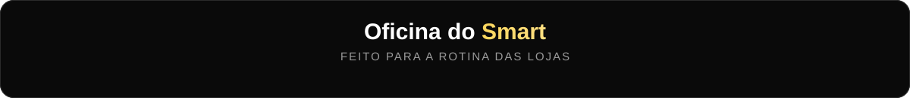

<div align="center">


<br>


### Do pedido ao balcão, com rastro de cada peça.

**[Manetes](#-fluxo-da-manete)** · **[Fluxo](#-fluxo-da-peça)** · **[Funcionalidades](#-funcionalidades)** · **[Planilhas](#-importar-e-exportar-planilhas)** · **[Acesso](#-regras-de-acesso)** · **[Arquitetura](#-arquitetura)** · **[Como colocar no ar](#-como-colocar-no-ar)** · **[Segurança](#-segurança)**

</div>

<br>

Sistema web que acompanha cada peça **do pedido até o uso no balcão** nas lojas **Buritis, Savassi, Centro, Belvedere e Castelo**, mais o **Estoque Central**.

Cada peça física tem **código próprio** (ex.: `PED-0001-01`) e um **rastro completo** de tudo o que aconteceu com ela: **quem mexeu, quando e por quê**. Sem planilha perdida, sem "quem pegou aquela tela?".

<br>



<br>

## 🎮 Fluxo da manete

A manete chega da loja de origem com o número da OS, o **técnico** cadastra e atualiza o status, e **todos acompanham** em **Manutenção de Manetes**.



> **Novidade:** perfil **Técnico**, aba **Fechamento Técnico** e **Manutenção de Manetes** (cadastrar, editar, atualizar status e excluir).

<br>

## 🔄 Fluxo da peça



E quando a peça foge do caminho feliz, tudo continua registrado:



<br>

## ✨ Funcionalidades

<table>
<tr>
<td width="50%" valign="top">

### 📦 Pedidos
A loja solicita escolhendo o **fornecedor** e o **valor da peça**. O pedido já nasce **aprovado**, sem esperar o administrador. O admin registra compra, recebimento e entrega, e tem **poder total para excluir** qualquer pedido.

### 🧩 Controle de Peças
Todas as peças com código, local, status e valor. Utilizar, devolver, enviar para manutenção, descartar e **editar o status** (ex.: *tela iPhone 11 → Utilizada*). Clique no código para ver o **rastro completo**.

### 🔧 Manutenção (OS)
Ordens de serviço com **número da OS, cliente, serviço, peça utilizada, valor cobrado, valor pago na peça e técnico**. No rodapé: soma de **cobrado**, **gasto** e **lucro**.

### 🧾 Fechamento Técnico
Registro diário dos serviços dos técnicos: **OS, cliente, serviço, valor da peça, valor cobrado e fornecedor**. Cada preenchimento vira um **registro individual** com a **data salva automaticamente**. Todos consultam (busca, período e totais); o técnico pode filtrar **só os seus**.

### 🪟 Reparo em Vidro
Controle dos reparos em vidro: **OS, loja, modelo do aparelho e status** (*Pronto*, *Em manutenção* ou *Display danificado*) e **observação**; o botão **+ Cadastrar serviço** só aparece para quem tem a marca da Paola (admin dá em Usuários > Editar). **Todos veem**; **só a Paola** (marca `is_glass_editor` no perfil) cadastra, atualiza, edita e exclui.

### 🎮 Manutenção de Manetes
Controle das manetes em reparo: **OS, loja de origem e status** (*Aguardando peças*, *Sem reparo*, *Pronta* ou *Enviada para reparo em placa*). **Todos veem**; **só o técnico** cadastra, atualiza, edita e exclui.

</td>
<td width="50%" valign="top">

### 🏬 Estoques
Matriz **peça × local** com quantidade e valor. Dá para:
- **cadastrar peça** direto na **loja escolhida** (nome, modelo, quantidade, loja, fornecedor e valor; se a peça já existe, só soma);
- dar **entrada em lote** de peças já cadastradas;
- fazer **saída** do central para uma loja;
- **excluir peça** com um clique (o histórico é mantido);
- **importar e exportar planilhas** ([veja abaixo](#-importar-e-exportar-planilhas)).

### 🏭 Estoque Central
Aba aberta a **todos os usuários**: quantidade disponível por peça, valor unitário e valor total, com busca. Funcionários e técnicos só consultam; a movimentação é do administrador.

### 🔁 Transferências
Entre lojas, o pedido passa por **OK da loja de origem → aprovação do admin**. Nada some no meio do caminho.

### 📚 Catálogo e Fornecedores
O catálogo guarda **fornecedor padrão** e **valor**; nos pedidos, tudo entra sozinho. O histórico de compras fica por fornecedor.

### 📊 Dashboard, Histórico e Relatórios
Pedidos por unidade, peças mais usadas e devolvidas, movimentação mensal. **Histórico permanente** com busca e filtros e exportação em **CSV** (abre no Excel).

### 👥 Usuários
O admin cria acessos (**funcionário**, **técnico** ou **administrador**), promove ou remove admins, redefine senhas, troca a loja, ativa, desativa e **exclui**. Tudo dentro de um único botão **Editar**.

</td>
</tr>
</table>

<br>

## 📥 Importar e exportar planilhas

Na aba **Estoques**, dois botões fazem o trabalho pesado:

| Botão | O que faz |
|---|---|
| **Exportar planilha** | Baixa um `.xlsx` com uma linha por peça: fornecedor, valor unitário, quantidade em **cada local**, total e valor em estoque. |
| **Importar planilha** | Lê `.xlsx` ou `.csv` (inclusive o CSV com `;` do Excel brasileiro), mostra uma **prévia linha por linha** e só então lança no estoque. |

**Colunas da importação** (o botão **Baixar modelo** já entrega a planilha pronta):

| Peça | Modelo | Loja | Quantidade | Fornecedor | Valor unitário |
|---|---|---|---:|---|---:|
| BATERIA | S22 | Buritis | 5 | Canal das peças | 45,90 |
| TELA | S23 | *(vazio = Estoque Central)* | 2 | Canal das peças | 320 |

- **Soma, não substitui:** as quantidades entram por cima do que já existe.
- **Loja:** a peça entra no Estoque Central e sai para a loja informada, e os **dois movimentos ficam no Histórico**.
- **Fornecedor e valor** só são obrigatórios para **peça nova** (ou sem padrão no catálogo).
- **Validação antes de lançar:** loja inexistente, fornecedor desconhecido e quantidade inválida aparecem na prévia com o motivo, e **só as linhas OK entram**.

> [!NOTE]
> A planilha exportada tem uma coluna por loja (visão de consulta). Para importar, use o formato de uma linha por peça e loja, igual ao modelo.

<br>

## 🔁 Transferência entre lojas



<br>

## 🔐 Regras de acesso

As regras valem **dentro do banco de dados** (Row Level Security e funções do Postgres), e não só nos botões da tela. Esconder um botão não protege nada; aqui, o banco recusa.

| | 👑 Administrador | 🧑‍💼 Funcionário | 🔧 Técnico |
|---|:---:|:---:|:---:|
| Enxerga | **todas as lojas** | só a própria loja | só a própria loja |
| Faz pedidos (nascem aprovados) | ✅ | ✅ | ✅ |
| Compra, recebe e entrega pedidos | ✅ | — | — |
| Usa, devolve e manda peça para manutenção | ✅ | ✅ | ✅ |
| Cadastra manutenções (OS) | ✅ | ✅ | ✅ |
| Pede transferência | ✅ | ✅ | ✅ |
| Dá o OK como loja de origem | — | ✅ | ✅ |
| Aprova transferência | ✅ | — | — |
| **Consulta** o Estoque Central | ✅ | ✅ | ✅ |
| Cadastra/exclui peça, importa/exporta planilha, dá saída do central | ✅ | — | — |
| Cadastra peça no estoque **da própria loja** (Controle de Peças) | — | — | ✅ |
| Vê Fechamento Técnico, Manetes e Reparo em Vidro (todas as lojas) | ✅ | ✅ | ✅ |
| **Escreve** no Fechamento Técnico e nas Manetes | — | — | ✅ |
| **Escreve** no Reparo em Vidro | só a Paola | só a Paola | só a Paola |
| Exclui pedidos, manutenções e peças do catálogo | ✅ | — | — |
| Gerencia usuários e usa **Logar como** | ✅ | — | — |

- 🛠️ **Desenvolvedor**: tem tudo do administrador e, no fim do menu, as abas **Auditoria**, **Diagnóstico do sistema**, **Backup e dados** e **Erros do sistema** (veja abaixo). Só o dev lê essas tabelas, e o banco recusa qualquer outro usuário.
- Pode haver **mais de um administrador**. Funcionário só vira admin se outro admin promover; o técnico é definido em **Usuários → Tornar técnico**.
- 🚫 **Usuário desativado** perde o acesso na hora.
- O cadastro público fica **desligado**: **só o administrador cria acessos**.

<br>

## 🛠️ Painel do desenvolvedor

Visível só para o **dev** (seção *Desenvolvedor* no fim do menu). Requer rodar o `migracao_dev_painel.sql` uma vez.

| Aba | Para que serve |
|---|---|
| **Auditoria** | Quem promoveu ou rebaixou admin, dev e técnico, redefiniu senha, ativou, desativou, trocou de loja, criou ou excluiu usuário, usou o **Logar como** e exportou backup. Filtros por pessoa, ação e data, com CSV. O registro só recebe inclusão. |
| **Diagnóstico do sistema** | Confere funções, tabelas, colunas, gatilhos e RLS esperados pelo site e diz **qual arquivo `.sql` rodar** quando algo falta. Também mostra devs e admins ativos, usuários sem loja e técnicos que são admin. |
| **Backup e dados** | **Exportar tudo** (`.xlsx` com uma aba por tabela, ou `.json`). Confere o total lido contra o total do banco e avisa se faltar linha. |
| **Erros do sistema** | O que falhou na tela dos usuários (função faltando, permissão, rede, erro de script) com quem, onde e quando. Avisos de regra, como "Informe a OS", ficam separados. Dá para marcar como resolvido e limpar. |

> **Como a auditoria funciona:** gatilhos na tabela `profiles` (e em `auth.users` para senha) gravam em `audit_log`, então vale para qualquer função `admin_*`, inclusive a que mexe com dev. O **Logar como** é gravado pela Edge Function: **republique** `backend/edge-function/logar-como.ts` para ele aparecer.

<br>

## 🧱 Arquitetura



| | |
|---|---|
| **Front-end** | HTML, CSS e JavaScript puros, **sem etapa de build** |
| **Login e banco** | [Supabase](https://supabase.com): Auth + Postgres + RLS |
| **Planilhas** | [SheetJS](https://sheetjs.com) (`.xlsx`), carregado por CDN com versão fixa |
| **Hospedagem** | [Cloudflare](https://www.cloudflare.com), deploy automático a cada `git push` |

### Estrutura do projeto




<br>

## 🚀 Como colocar no ar

<details>
<summary><b>1 · Banco de dados (Supabase)</b></summary>

<br>

1. Crie um projeto no [Supabase](https://supabase.com).
2. Abra o **SQL Editor**, cole o `supabase.sql` **inteiro** e execute. Pode rodar de novo sem perder dados, mas **ele volta a senha do administrador para a inicial**.
3. Em **Authentication → Providers → Email**, desative **Allow new users to sign up**.
4. Em **Authentication → URL Configuration**, coloque o endereço do seu site em **Site URL**.

**Banco que já está em uso?** Rode só as migrações que faltam. Nenhuma apaga dados e todas podem ser rodadas mais de uma vez:

| Arquivo | Para quê |
|---|---|
| `migracao_usuarios_estoque.sql` | Vários administradores e Estoque Central visível a todos |
| `migracao_estoque_central.sql` | Função que garante o Estoque Central visível a técnicos e funcionários |
| `migracao_visibilidade.sql` | Todo usuário novo enxerga os dados da própria loja e o histórico do central |
| `migracao_excluir_usuario.sql` | Administrador exclui usuários |
| `migracao_excluir_peca.sql` | Botão **Excluir** da aba Estoques (a peça sai do catálogo e das lojas; o histórico fica) |
| `migracao_tecnico.sql` | Perfil de técnico, **Fechamento Técnico** e **Manutenção de Manetes** (cadastrar, editar, atualizar status e excluir) |
| `migracao_peca_tecnico.sql` | **Técnico cadastra peça** direto no estoque da própria loja (aba Controle de Peças) |
| `migracao_reparo_vidro.sql` | Aba **Reparo em Vidro** (todos veem; só a Paola cadastra, edita, atualiza o status e exclui) |
| `migracao_dev_painel.sql` | **Painel do desenvolvedor**: Auditoria, Diagnóstico do sistema, Backup e dados e Erros do sistema |

</details>

<details>
<summary><b>2 · Configuração do site</b></summary>

<br>

Em **Project Settings → API**, copie a *Project URL* e a chave **publishable/anon** para o `config.js`:

```js
const SB_URL = 'https://SEU-PROJETO.supabase.co';  // só o endereço, sem nada na frente
const SB_KEY = 'sb_publishable_...';               // chave pública
```

> [!WARNING]
> Use sempre a chave **publishable/anon**. **Nunca** coloque a `service_role` no site.

</details>

<details>
<summary><b>3 · Publicação (Cloudflare)</b></summary>

<br>

1. Suba o projeto para o GitHub.
2. Na Cloudflare, em **Workers & Pages**, conecte o repositório. Deixe o *build command* vazio e use `npx wrangler deploy` como comando de deploy.
3. Ative o endereço `workers.dev` em **Settings → Domains & Routes**, ou use um domínio próprio.

Cada `git push` na branch `main` publica a nova versão sozinho.

</details>

<details>
<summary><b>4 · Primeiro acesso</b></summary>

<br>

O `supabase.sql` cria o login do administrador. **Entre e troque a senha imediatamente** em **Usuários → Redefinir senha**.

Para criar outros acessos, use **Usuários → + Novo usuário** e escolha o perfil (**Funcionário**, **Técnico** ou **Administrador**), ou clique em **Tornar técnico** / **Tornar admin** em quem já existe.

</details>

<details>
<summary><b>Botão "Logar como" (opcional)</b></summary>

<br>

O administrador entra na conta de funcionários e técnicos, sem a senha, pelo botão **Logar como** em **Usuários**. Para isso, publique uma função no Supabase:

1. Abra **Edge Functions → Deploy a new function → Via Editor**.
2. Cole o conteúdo de `backend/edge-function/logar-como.ts`. O Supabase pode gerar um nome automático (ex.: `smooth-service`). O nome usado pelo site está em `script.js`, na linha com `sb.functions.invoke(`, e precisa ser igual ao da função publicada (hoje: `smooth-service`).
3. Nas configurações da função, **desligue "Verify JWT"** (a própria função confere se quem chamou é administrador) e publique.

Só administradores ativos usam, e não funciona para outro administrador nem para usuário desativado. Enquanto estiver na conta de outra pessoa, aparece uma faixa no topo com **Voltar para minha conta**.

> [!IMPORTANT]
> O que for feito ali fica registrado **no nome dessa pessoa**.

</details>

<details>
<summary><b>Rodar na sua máquina</b></summary>

<br>

Não tem build. É só servir a pasta:

```bash
git clone https://github.com/henriquefbarrado/Oficina-do-Smart.git
cd Oficina-do-Smart
# edite o config.js com a URL e a chave publishable do seu Supabase
python3 -m http.server 8080      # ou: npx serve .
```

Abra `http://localhost:8080`.

</details>

<br>

## ❓ Dúvidas rápidas

<details>
<summary><b>Excluir uma peça apaga o histórico?</b></summary>

<br>

Não. A peça sai do catálogo e as unidades em estoque ficam com o status **Descartada**, então o rastro de cada código continua intacto. A exclusão é bloqueada se a peça ainda tiver unidade pedida, em manutenção, em devolução ou em transferência pendente.

</details>

<details>
<summary><b>A importação soma ou substitui o estoque?</b></summary>

<br>

**Soma.** Cada linha é uma entrada, e fica registrada no Histórico como qualquer outra.

</details>

<details>
<summary><b>E se a importação falhar no meio?</b></summary>

<br>

As linhas que já foram lançadas ficam lançadas, e o resultado final lista cada linha que falhou e o motivo. Corrija só essas linhas e importe de novo.

</details>

<br>

## 🔒 Segurança

- A **segurança está no banco** (RLS e funções do Postgres). A `publishable/anon` no `config.js` é feita para ser pública; o que protege os dados são as regras do banco.
- **Não deixe o `supabase.sql` em repositório público.** Ele contém a senha inicial do administrador. O `.gitignore` já o bloqueia; guarde-o fora do GitHub.
- Mantenha o `.assetsignore` para a Cloudflare **não publicar** arquivos que o site não usa (`*.sql`, `backend/` etc.).
- Nunca versione tokens de API, a chave `service_role` ou senhas.

<br>


