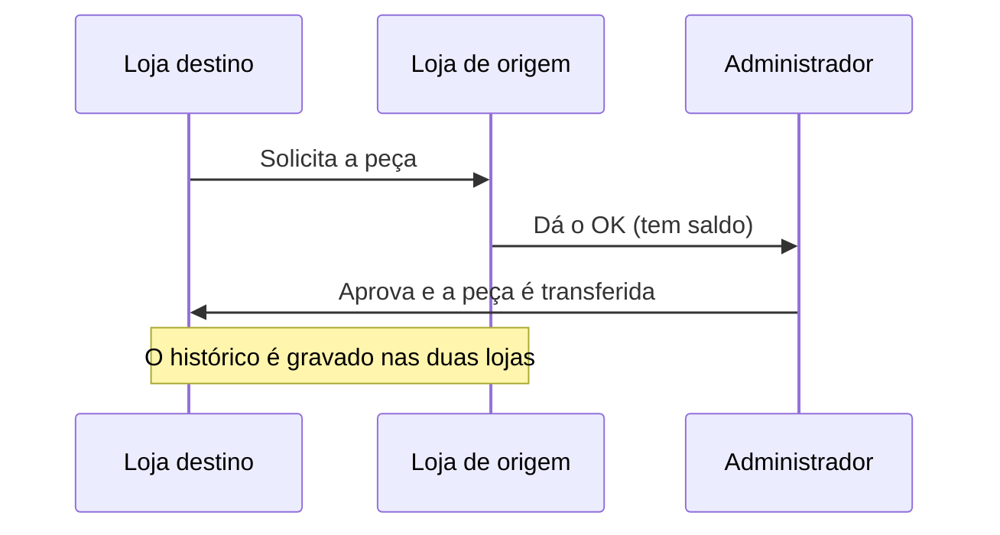

<div align="center">



<br>


**[Funcionalidades](#-funcionalidades)** · **[Fluxo da peça](#-fluxo-da-peça)** · **[Regras de acesso](#-regras-de-acesso)** · **[Como colocar no ar](#-como-colocar-no-ar)** · **[Segurança](#-segurança-do-repositório)**

</div>

<br>

Sistema web que acompanha cada peça **do pedido até o uso no balcão** nas lojas Buritis, Savassi, Centro, Belvedere e Castelo, mais o Estoque Central. Cada peça física tem **código próprio** (ex.: `PED-0001-01`) e um **rastro completo** de tudo o que aconteceu com ela: quem mexeu, quando e por quê.

<br>

## 🔄 Fluxo da peça


<br>

## ✨ Funcionalidades

<table>
<tr>
<td width="50%" valign="top">

### 📦 Pedidos
A loja solicita escolhendo o **fornecedor** e o **valor da peça**. O pedido já nasce **aprovado**, sem esperar o administrador. O admin registra compra, recebimento e entrega, e tem **poder total para excluir** qualquer pedido.

### 🧩 Controle de Peças
Todas as peças com código, local, status e valor. Utilizar, devolver, enviar para manutenção, descartar e **editar o status** (ex.: *tela iPhone 11 → Utilizada*). Clique no código para ver o rastro.

### 🔧 Manutenção (OS)
Cadastro de ordens de serviço com **número da OS, cliente, serviço realizado, peça utilizada, valor cobrado, valor pago na peça e técnico**. No rodapé, a soma de **valor cobrado**, **valor gasto** e **lucro**.

</td>
<td width="50%" valign="top">

### 📚 Catálogo e Fornecedores
Cadastre a peça uma vez, com fornecedor padrão e valor. Nos pedidos, tudo entra sozinho. O histórico de compras fica por fornecedor.

### 🏬 Estoques e Transferências
Saldo e valor por local, entrada no Estoque Central e saída para lojas. Entre lojas, a transferência passa por **OK da loja de origem → aprovação do admin**.

### 📊 Dashboard, Histórico e Relatórios
Pedidos por unidade, peças mais usadas e devolvidas, movimentação mensal. Histórico permanente com busca e filtros, e exportação em **CSV** (abre no Excel).

### 👥 Usuários
O admin cria acessos, redefine senhas, troca a loja e ativa ou desativa pessoas.

</td>
</tr>
</table>

### Transferência entre lojas



<br>

## 🔐 Regras de acesso

As regras valem **dentro do banco de dados** (Row Level Security e funções do Postgres), e não só nos botões da tela.

| Quem | O que pode |
|---|---|
| 👑 **Administrador** | Único do sistema. Vê e movimenta todas as unidades, compra, recebe, entrega, exclui pedidos, manutenções e peças do catálogo, e gerencia usuários. |
| 🧑‍🔧 **Funcionário** | Entra só na própria loja. Faz pedidos (sem aprovação), usa e devolve peças, cadastra manutenções e pede transferências. **Nunca vira administrador.** |
| 🚫 **Usuário desativado** | Perde o acesso na hora. |

O cadastro público fica desligado: **só o administrador cria acessos**.

<br>

## 🧱 Como é feito

| | |
|---|---|
| **Front-end** | HTML, CSS e JavaScript puros, sem etapa de build |
| **Login e banco** | [Supabase](https://supabase.com): Auth + Postgres + RLS |
| **Hospedagem** | [Cloudflare](https://www.cloudflare.com), com deploy automático a cada `git push` |

```
index.html        estrutura da página
script.js         telas e chamadas ao banco
style.css         visual (tema preto e amarelo)
config.js         URL e chave pública do Supabase
supabase.sql      banco de dados completo (rodar no Supabase)
wrangler.jsonc    configuração da hospedagem
assets/           imagens animadas deste README
```

> `gestpecas.html`, `app.js` e as pastas `web/` e `backend/` são de versões antigas e não são usados pelo site.

<br>

## 🚀 Como colocar no ar

<details>
<summary><b>1 · Banco de dados (Supabase)</b></summary>

<br>

1. Crie um projeto no [Supabase](https://supabase.com).
2. Abra o **SQL Editor**, cole o `supabase.sql` **inteiro** e execute. Pode rodar de novo sem perder dados.
3. Em **Authentication → Providers → Email**, desative **Allow new users to sign up**.
4. Em **Authentication → URL Configuration**, coloque o endereço do seu site em **Site URL**.

</details>

<details>
<summary><b>2 · Configuração do site</b></summary>

<br>

Em **Project Settings → API**, copie a *Project URL* e a chave **publishable/anon** para o `config.js`:

```js
const SB_URL = 'https://SEU-PROJETO.supabase.co';  // só o endereço, sem nada na frente
const SB_KEY = 'sb_publishable_...';               // chave pública
```

> ⚠️ Use sempre a chave **publishable/anon**. Nunca coloque a `service_role` no site.

</details>

<details>
<summary><b>3 · Publicação (Cloudflare)</b></summary>

<br>

1. Suba o projeto para o GitHub.
2. Na Cloudflare, em **Workers & Pages**, conecte o repositório. Deixe o *build command* vazio e use `npx wrangler deploy` como comando de deploy.
3. Ative o endereço `workers.dev` em **Settings → Domains & Routes**, ou use um domínio próprio.

Cada `git push` na branch `main` publica a nova versão sozinho.

</details>

<details>
<summary><b>4 · Primeiro acesso</b></summary>

<br>

O `supabase.sql` cria o login do administrador. **Entre e troque a senha imediatamente** em **Usuários → Redefinir senha**.

</details>

<br>

## 🛡️ Segurança do repositório

- **Não deixe o `supabase.sql` em repositório público.** Ele contém a senha inicial do administrador. Guarde-o fora do GitHub ou remova a senha antes de publicar.
- Mantenha um `.assetsignore` para a Cloudflare **não publicar** arquivos que o site não usa (`*.sql`, `backend/`, `web/` etc.).
- Nunca versione tokens de API, a chave `service_role` ou senhas.

<br>


